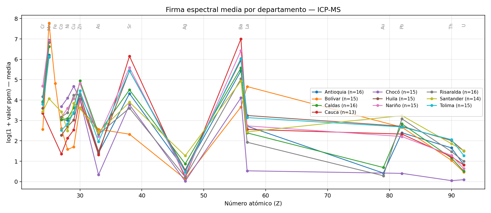
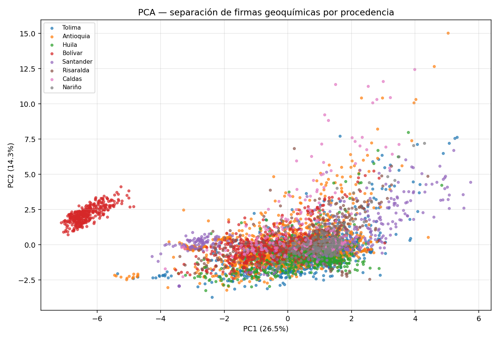
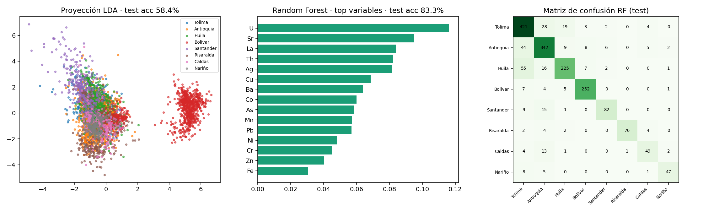

# HDM Geochemistry Explorer · ML para procedencia de muestras geoquímicas

> **Demo de portafolio** derivada del proyecto **Huella Digital de Minerales** (Servicio Geológico Colombiano), donde soy desarrollador FullStack & Data Scientist. Esta versión corre 100 % local sobre una muestra de datos y reproduce el núcleo analítico de la plataforma en producción.

| | |
|---|---|
| **Contexto** | Plataforma institucional que integra, estandariza y analiza **5,4 millones de registros geoquímicos** de muestras minerales de toda Colombia |
| **Mi rol** | Data Science + desarrollo: diseño de variables, modelos ML, app analítica, ETL espacial y dashboards |
| **Impacto en producción** | Precisión **92 %** (validación cruzada) en clasificación de procedencia de oro · reducción del **30 %** en tiempos de análisis de los geólogos |
| **Stack producción** | Python, scikit-learn, R (Shiny, FactoMineR, randomForest), PostgreSQL/PostGIS, Oracle, Java (Spring Boot), Angular, Power BI |
| **Stack demo** | Python, Shiny para Python, Plotly, Folium, scikit-learn, SQLite |

---

## El problema

La procedencia geográfica de una muestra mineral deja una **firma geoquímica**: proporciones sistemáticas de elementos traza (Au-As-Sb, Cu-Pb-Zn, REE,…) que delatan el yacimiento de origen. Clasificar esa procedencia manualmente es lento y subjetivo; con millones de registros se vuelve inviable.

## La solución

Un pipeline end-to-end que convierte datos crudos de laboratorio en decisiones:

1. **Estandarización SQL** — conversión a ppm por dominio de unidades y transformación **CLR** (log-ratio centrado, estándar en geoquímica) implementada en vistas materializadas de PostgreSQL (`sql/01_vista_base_postgres.sql`).
2. **Enriquecimiento espacial** — unión espacial (GeoPandas + PostGIS) que asigna municipio/departamento/distrito a cada muestra.
3. **Exploración interactiva** — app Shiny con filtros en cascada, espectros químicos ordenados por número atómico, diagramas XY/ternarios y correlaciones.
4. **Machine Learning** — clasificación supervisada de procedencia con **LDA** y **Random Forest** (imputación por mediana, `log1+x`, estandarización, split estratificado 70/30).

```
ATLAS (laboratorios, Oracle) ──► ETL GeoPandas + PL/SQL ──► PostgreSQL (vistas CLR)
        │                                                        │
        └──► SQLite analítico (5,3 GB, 17 índices)                ▼
                          │                          App Shiny: EDA + PCA + LDA + RF
                          ▼
                 Dashboards operativos (Power BI style)
```

## Resultados (demo con 16 elementos, 5.980 muestras)



Firmas espectrales medias por departamento: las diferencias sistemáticas son la señal que explotan los modelos.



PCA (26,5 % + 14,3 % de varianza en 2 componentes): las procedencias forman grupos parcialmente separables.



| Modelo | Accuracy test (demo) | Accuracy producción* |
|---|---|---|
| Random Forest (100 árboles, balanceado) | **83,3 %** | **92 %** |
| LDA (proyección 2D) | 58,4 % | 86 % |

\* Producción usa el set completo de 108+ elementos, feature engineering CLR y etiquetas de yacimiento (no solo departamento).

## Qué explora la demo

| Pestaña | Qué demuestra |
|---|---|
| **Operativo** | Réplica del tablero productivo: KPIs, treemap de laboratorios y barras por tipo — estilo Power BI |
| **Mapa** | Folium + MarkerCluster sobre 5.992 muestras georreferenciadas |
| **Espectro** | Composición media por grupo, ordenada por número atómico (Z) |
| **Correlación** | Asociación entre elementos en escala log |
| **PCA** | Reducción de dimensionalidad + varianza explicada |
| **Machine Learning** | LDA, Random Forest, matriz de confusión, importancia de variables |
| **Tabla** | DataGrid con filtros y descarga CSV (Excel-friendly, `utf-8-sig`) |

## Ejecutar la demo

```bash
git clone https://github.com/Jonny-Monroy/geochem-ml-hdm.git
cd geochem-ml-hdm
pip install -r requirements.txt
shiny run app/app.py --reload
# → http://127.0.0.1:8000
```

La base demo (`data/hdm_demo.sqlite.zip`, 360.763 registros · 5.992 muestras · 108 elementos) se descomprime automáticamente al primer arranque. Regenerar las figuras: `python docs/generar_figuras.py`.

## Datos

Muestra anonimizada extraída del pipeline productivo (técnica ICP-MS multielemento): solo columnas analíticas, sin datos personales ni información sensible. Publicada con fines demostrativos/educativos. **Los datos completos y la app de producción son propiedad del Servicio Geológico Colombiano.**

## Aprendizajes clave

- La **transformación CLR** es indispensable en geoquímica: los datos son composicionales (suma cerrada) y el log-ratio evita correlaciones espurias.
- La **imputación por mediana + log1p** estabiliza distribuciones fuertemente sesgadas (Límites de detección: `<0,0004 ppm`).
- Un **Random Forest balanceado** con 30-40 predictores bien elegidos supera a modelos lineales cuando las clases tienen geometrías no lineales.
- Llevar el mismo análisis de R (Shiny + FactoMineR) a Python (Shiny + scikit-learn) permitió integrarlo a la plataforma web Spring Boot/Angular del SGC.

## Contacto

**Jonny Alejandro Monroy Chavez** · Data Scientist / GIS FullStack · Bogotá, Colombia
[jhonny.a.monroy@gmail.com](mailto:jhonny.a.monroy@gmail.com) · [LinkedIn](https://linkedin.com/in/jonny-alejandro-monroy-chavez) · [GitHub](https://github.com/Jonny-Monroy)
